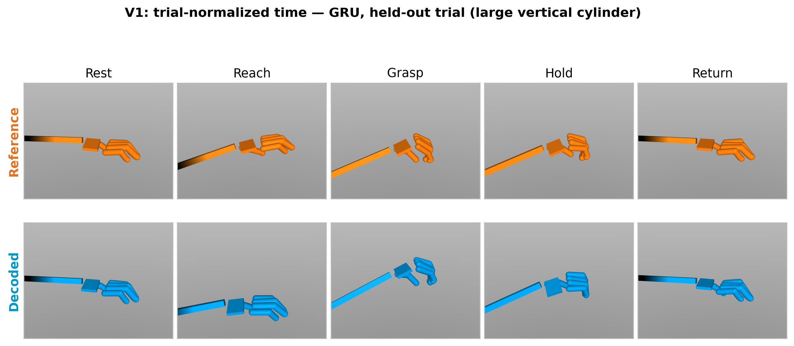
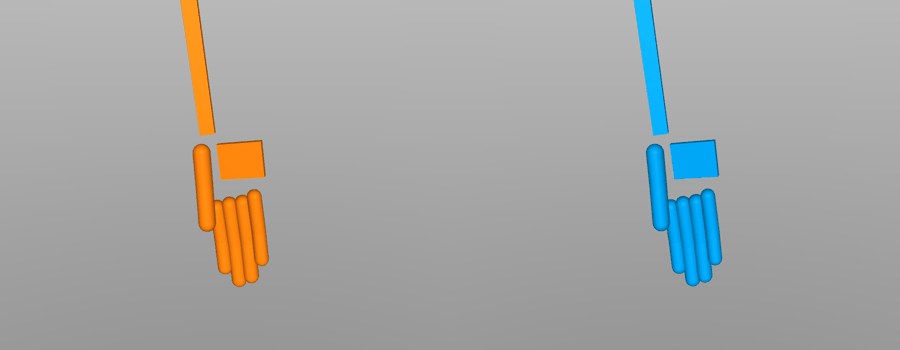
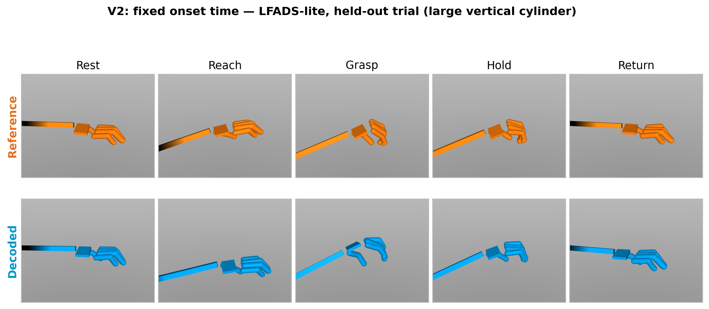
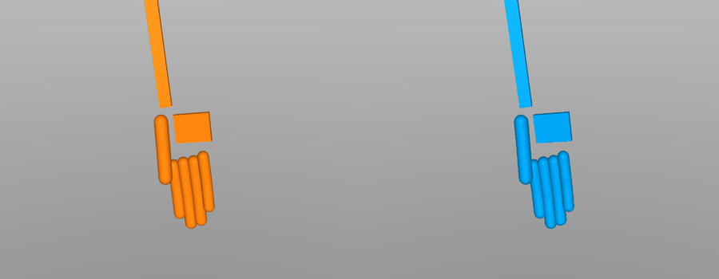

# Arm and Hand Kinematics Decoding for Online Invasive BCI

Master's thesis source code by **Anita Iotti** (me) for decoding hand and arm kinematics from intracortical neural recordings.

The project compares linear and non-linear neural decoders for 32 joint coordinates, evaluates generalization across held-out trials, movements, recording blocks and sessions, and visualizes reference and decoded movements in MuJoCo.

## Reference and decoded movement

The thesis figures below compare the **prescribed reference trajectory** in orange with the **decoded trajectory** in cyan. Both trajectories are replayed through the same simulated arm and hand. The reference is the movement presented to the participant, rather than a measurement of the participant's limb. These are replays of held-out test trials.

### V1: GRU with object context

Trial-normalized time input, `t / (T - 1)`. The stills show rest, reach, grasp, hold and return for a held-out large vertical cylinder trial.





### V2: LFADS-lite with object context

Fixed onset time input, `t / 600`, corresponding to a six-second clock at 100 Hz. The same trial and visualization layout are used for comparison.





## What the code covers

- Data loading, causal neural preprocessing, PCA and reproducible train/validation/test splits.
- Ridge, Kalman/ReFIT-style, GRU, LFADS-lite and Transformer decoder implementations.
- Posture, velocity and combined position/velocity prediction, with optional kinematic PCA.
- Comparisons with and without object context, perturbation controls, per-joint metrics and output filtering.
- Streaming decoder integration and scripts for replaying reference and decoded trajectories.

The two experiment versions use the same dataset and evaluation structure while varying the elapsed-time input. Model and preprocessing choices are selected using validation data.

## Repository contents

| Path | Purpose |
| --- | --- |
| [thesis_notebook.ipynb](thesis_notebook.ipynb) | Analysis notebook with its saved thesis outputs and chapter-by-chapter code. |
| [plotting_functions/](plotting_functions/) | Result loading, plotting, model loading and simulation/presentation helpers written for the thesis. |
| [run_v1/functions/](run_v1/functions/) | V1 training, evaluation and streaming scripts. |
| [run_v2/functions/](run_v2/functions/) | V2 training, evaluation and streaming scripts; `run_final.py` is the training entry point. |
| [data/print_trial_durations.py](data/print_trial_durations.py) | Script for summarizing trial durations on a machine that has the recordings. |
| [assets/](assets/) | Selected stills and animations for this README. |
| [requirements.txt](requirements.txt) | Python dependencies and versions used by the thesis code. |

This is a **source-only edition**. It includes the project's scripts, notebook, documentation and the selected README media. It excludes raw recordings, supplied movement templates, third-party MuJoCo model XML/mesh files, trained model weights, saved evaluation datasets, generated figure/table archives, local environments and caches.

## Setup and notebook

Use **Python 3.10**, matching the training environment:

```bash
python3.10 -m venv .venv
source .venv/bin/activate
python -m pip install --upgrade pip
python -m pip install -r requirements.txt
jupyter lab thesis_notebook.ipynb
```

On Windows, activate the environment with `.venv\Scripts\Activate.ps1`.

The notebook retains its previously saved outputs, so they can be inspected without the experiment files. **A complete rerun requires external recordings and/or experiment artifacts, depending on the section.** Installing the Python packages alone does not supply those inputs. The repository is not a self-contained dataset or pretrained-model release.

If the notebook preview is unavailable in a browser, download the notebook and open it in JupyterLab or VS Code. The comparison images above can be viewed directly on this page.

## External inputs for reproduction

The source preserves the original relative paths. Supply the relevant inputs locally before rerunning the corresponding sections:

```text
data/patient_sessions/                  # recording blocks, for raw-data inspection and training
data/recorded_attempt_durations.csv     # duration summary generated from the recordings
run_v1/models/                         # trained V1 decoder artifacts
run_v1/results/                        # V1 evaluations, split metadata and replay arrays
run_v2/models/                         # trained V2 decoder artifacts
run_v2/results/                        # V2 evaluations, provenance, predictions and replay arrays
run_v1/functions/new_info/             # compatible external model assets and reference templates
run_v2/functions/new_info/             # compatible external model assets and reference templates
```

These inputs are intentionally absent from Git history and covered by `.gitignore`. The MuJoCo Python package is a dependency; the external arm/hand model, meshes and supplied reference trajectories are separate inputs. The original scene filenames and control ordering are documented by the replay and metadata-parsing code. The existing README images need no simulator installation to view.

For training commands and expected recording layout, see [V1 training](run_v1/functions/README.md), [V2 training](run_v2/functions/README.md) and [recording inputs](data/README.md).

Training requires the recording blocks and the protocol/reference inputs expected by the selected pipeline. Full experiment grids are computationally expensive. Streaming scripts provide integration code and offline tests; a live BCI deployment additionally requires its recording and streaming infrastructure.
